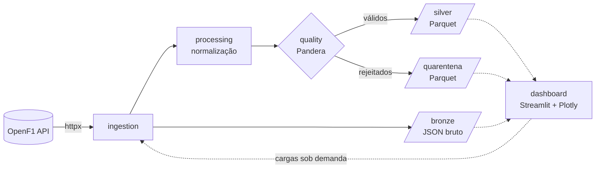

# Arquitetura

## Fluxo de dados

A unidade de trabalho é um **meeting** (fim de semana de GP). A pipeline de temporada carrega o calendário do ano e depois cada meeting já encerrado, em sequência.

## Camadas

| Camada | Responsabilidade | Depende de |
|---|---|---|
| `domain` | `Endpoint`, `DatasetSpec`, entidades (`MeetingRef`, `SessionRef`, `Partition`, `Filter`) e contratos (`OpenF1Source`, `RawStore`, `DatasetStore`) | nada |
| `ingestion` | Query string com operadores e cliente HTTP com retry/backoff | `domain`, `config` |
| `processing` | Normalização tipada, colunas de linhagem e agregações analíticas da temporada (`standings.py`: pontos, vitórias, pódios, vencedores, KPIs) | `domain`, `utils` |
| `quality` | Schemas Pandera e separação válidos/rejeitados | `domain` |
| `storage` | Bronze JSON, silver Parquet e quarentena | `domain` |
| `pipelines` | Orquestração `calendar` → `meeting` → `season`, `results` (drivers + resultados de várias sessões em lote) e `factory` (composição dos stores) | todas |
| `config` / `utils` | Settings, logging JSON, métricas, datas | — |
| `dashboard` (apresentação) | `loaders.py` lê o lake; `bootstrap.py` dispara cargas sob demanda; `views/` monta as páginas (Streamlit + Plotly); `dashboard.py` é o roteador multipage | todas |

O dashboard não contém regra de negócio:

- as agregações ficam em `f1.processing.standings`, como funções puras;
- a leitura do lake fica em `f1.dashboard.loaders`;
- as cargas da API reaproveitam as pipelines existentes, por meio de `f1.dashboard.bootstrap`;
- as páginas de `f1.dashboard.views` só compõem a tela.

Como o arquivo `dashboard.py` e o pacote `dashboard/` compartilham o nome `f1.dashboard`, o `dashboard.py` é executado pelo caminho (`streamlit run`) e checado pelo MyPy numa etapa própria.

As implementações concretas são compostas em dois pontos de entrada: a CLI (`src/f1/__main__.py`) e o dashboard (`f1.dashboard.bootstrap`). Ambos usam `f1.pipelines.factory.build_stores`. As pipelines recebem a fonte e os stores por parâmetro, o que permite testá-las com uma fonte falsa em memória.

## Decisões

- **Idempotência por overwrite de partição.** Cada dataset de um meeting é gravado em `season=YYYY/meeting_key=N/part-00000.parquet`, num diretório de staging que só substitui a partição final depois de escrito. Reexecutar produz o mesmo conteúdo (só mudam `_run_id` e `_ingested_at`). Sem rejeitados, a partição de quarentena é removida.
- **Bronze por sessão, silver por meeting.** A API é consultada por `session_key`; o bronze guarda um JSON por sessão e o silver concatena as sessões do meeting num único arquivo, o que evita arquivos pequenos (cerca de 24 por ano por dataset).
- **Validação em dois níveis.** Violações de schema (coluna ausente/extra, tipo errado) interrompem a pipeline na hora. Violações de linha (nulidade, faixa, unicidade da chave de negócio, consistência entre colunas) vão para a quarentena; acima de `F1_MAX_REJECTION_RATE` (5%) a pipeline grava a quarentena e falha com `DataQualityError`.
- **Cancelados.** Meetings e sessões com `is_cancelled=true` ficam no silver, mas não são processados pelas pipelines de sessão.
- **Rate limit não documentado.** Intervalo mínimo configurável entre requisições (`F1_REQUEST_INTERVAL_SECONDS`) e backoff exponencial em `429`/`5xx`/timeout, respeitando `Retry-After`.
- **Erros da API.** `404` é tratado como "sem dados" (lista vazia). `401`/`403` lançam `OpenF1AccessError` sem retry; isso acontece durante sessões ao vivo, quando a OpenF1 bloqueia o acesso gratuito.
- **Campos depreciados** (`country_code` em drivers, `pit_duration` em pit) não entram no silver.
- **Resultados em lote.** `run_results` busca `drivers` e `session_result` de várias sessões numa só requisição (`session_key` repetido, até 25 por lote). A temporada inteira de corridas e sprints sai em 2 requisições, e a gravação continua no padrão do meeting: bronze por sessão, silver e quarentena por meeting.
- **Sprints.** Na OpenF1 a sprint tem `session_type="Race"` e `session_name="Sprint"`; `SessionRef.is_race`, `is_sprint` e `awards_points` encapsulam essa regra.
- **Pontos** vêm de `session_results.points` (coluna adicionada nesta versão), que já inclui o ponto da volta mais rápida; vitórias e pódios contam apenas corridas principais.

## Observabilidade

Cada dataset é envolto em `track_pipeline`, que registra em JSON os eventos `pipeline_started`, `pipeline_finished` e `pipeline_failed` com `run_id`, `destination`, `records_read`, `records_processed`, `records_rejected` e `duration_seconds`. Um único `run_id` é gerado por execução da CLI e propagado a todos os eventos. Cada requisição HTTP gera um evento `openf1_request`.
